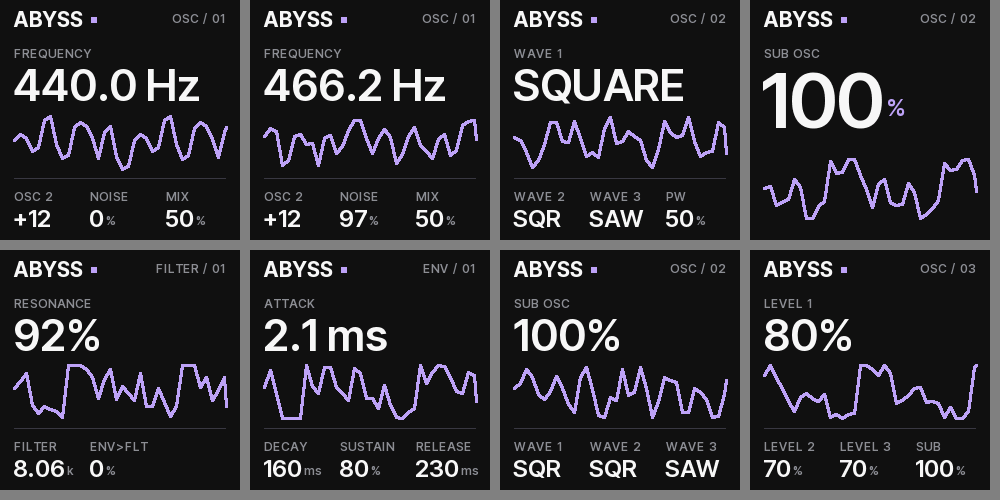

# ABYSS

Experimental noise synthesizer firmware for the M-VAVE FM-1, inspired by Death By Audio's APTBS Synthesizer.
Built on [felucca-bsp](https://github.com/hugelton/felucca-bsp) and Felucca's build tools.

**Version 1.0** — up to four voices with spread and glide, MIDI clock sync for the LFOs and delays, TRS and USB
MIDI (CCs, pitch bend, program change, sustain, velocity), stereo WIDTH, the envelope as a modulator, the last sound
remembered over a power-off; three oscillators with FM, cross mod, ring mod, hard sync and CHAOS; six noise types;
filter (LP/BP/HP), envelope, two LFOs and a random sample-and-hold; six drive types; two PT2399-style feedback
delays. 14 factory sounds and 10 user slots. See `docs/ARCHITECTURE.md`; installing: `docs/INSTALL.md`.



## Controls

Every page is one topic with four parameters on **K1–K4** (shown two by two: K1 K2 above, K3 K4 below). The left
knobs do the same job on every page.

| Control | Does |
|---|---|
| K1–K4 | the page's four parameters (turning one makes it the big value) |
| SELECT | turn through the pages |
| ALGORITHM | filter cutoff, on every page |
| PRESETS | turn through the sounds: 10 factory presets, then your saved ones (each loads as you land on it) |
| MASTER | output level |
| HOME | next page, round all seventeen |
| EDIT / ENV | FILTER / ENVELOPE |
| LFO | LFO 1 → LFO 2 → RANDOM → ENV MOD |
| SAVE | PRESETS page: K1 picks USER 1–10, press SAVE again to store the current sound |
| FX | DRIVE → DELAY 1 → DELAY 2 → DELAYS |
| GLO | performance mode: the current value huge |
| PLAY | DRONE on/off (lit while on) |
| REC | TAP: held, plays the current note |
| OCT− / OCT+ | octave (both: reset); both held at power-on: update mode after a 3 s countdown |
| Keys | MONO: last note priority; VOICES 2–4: chords; MIDI from the TRS jack and USB (see below) |

| # | Page | K1 | K2 | K3 | K4 |
|---|---|---|---|---|---|
| 1 | OSC 1 | FREQUENCY | WAVE | LEVEL | SUB OSC |
| 2 | OSC 2 | TUNE | WAVE | LEVEL | DETUNE 2/3 |
| 3 | OSC 3 | TUNE | WAVE | LEVEL | PULSE WIDTH |
| 4 | NOISE | LEVEL | TYPE | CHAOS | – |
| 5 | CROSS | FM 2 > 1 | X-MOD 1 <> 3 | RING 1 x 2 | SYNC |
| 6 | FILTER | CUTOFF | RESONANCE | ENV AMOUNT | TYPE (LP/BP/HP) |
| 7 | ENVELOPE | ATTACK | DECAY | SUSTAIN | RELEASE |
| 8 | DRIVE | TYPE | DRIVE | TONE | MIX |
| 9 | DELAY 1 | TIME | FEEDBACK | WOBBLE | PAN |
| 10 | DELAY 2 | TIME | FEEDBACK | WOBBLE | PAN |
| 11 | DELAYS | WET/DRY | X-FEEDBACK | TONE | ROUTING |
| 12 | LFO 1 | RATE | DEPTH | WAVE | TARGET |
| 13 | LFO 2 | RATE | DEPTH | WAVE | TARGET |
| 14 | RANDOM | RATE | DEPTH | SMOOTH | TARGET |
| 15 | ENV MOD | TARGET | AMOUNT (±) | VELOCITY | – |
| 16 | VOICE | VOICES (MONO, 2–4) | SPREAD | GLIDE | – |
| 17 | OUTPUT | STEREO WIDTH | MIDI CH | BEND | CLOCK (sync on/off) |

STEREO WIDTH: 0 % mono, 50 % as the delay pans place it, 100 % wider (the sides boosted plus a 10 ms Haas
offset). ENV MOD sends the envelope to any modulation target, positive or inverted; VELOCITY 0 % = every note
full level, 100 % = level follows how hard you play.

VOICES: MONO plays one note (last note wins, legato); 2–4 play chords, a new note taking a free voice or the
oldest. Each voice has its own oscillators, filter and envelope; noise, LFOs, drive and delays are shared. SPREAD
detunes the voices against each other (up to ±1 semitone); GLIDE slides each voice from its last note.

CLOCK ON + a MIDI clock coming in: LFO 1, LFO 2 and RANDOM rates become note divisions (8 BARS … 1/32, dotted and
triplets) and the delay times too (1/32 … 1/1); START restarts the LFOs on the beat. With no clock for 0.6 s they
go back to Hz and ms.

## MIDI

TRS MIDI IN (type A) and USB-MIDI, both at once. MIDI CH: OMNI or 1–16.

| Message | Does |
|---|---|
| Note on / off | plays (velocity per the VELOCITY setting) |
| Pitch bend | ± BEND semitones (0–24, default 2) |
| Program change 0–13 | factory preset 1–14; 14+ your saved sounds in list order |
| Clock, START | tempo for CLOCK sync; START restarts the LFOs |
| CC 1 | LFO 1 depth |
| CC 5 | glide |
| CC 16–19 | the current page's K1–K4 |
| CC 64 | sustain |
| CC 70 / 71 / 72 / 73 / 74 | drive / resonance / release / attack / cutoff |
| CC 91 | delay wet/dry |
| CC 120, 123 | all sound / notes off |

## Presets

Factory: 1 INDUSTRIAL DRONE · 2 METALLIC MACHINE · 3 BROKEN OSC · 4 FEEDBACK STORM · 5 DARK AMBIENT ·
6 DIGITAL COLLAPSE · 7 NOISE BURST · 8 RADIO INT · 9 SUBHARMONIC · 10 CHAOTIC MACHINE · 11 GHOST CHOIR (4 voices) ·
12 ACID TUNNEL (glide) · 13 BROKEN CHORDS (3 voices) · 14 FM BELLS (4 voices).
Power-on brings back the sound last chosen (the preset as stored, not unsaved edits) and the MIDI CH / BEND / CLOCK
settings (records appended to a sector at 0xF3000, written 3 s after a change). A sound changed since it loaded shows EDITED. User slots live in flash (two alternating
4 KiB sectors at 0xF0000, so a power cut during a save loses only that save); a save silences the audio for
~20 ms while the sector erases. The factory sounds use the drive and delays.

## Try it without hardware

Open <https://joakimeriksson.github.io/fm1-emu/>, choose to open a local package and pick `abyss.fwsc`.

## Build (macOS, Apple silicon)

Needs Python 3 with Pillow (`pip3 install Pillow`), Docker Desktop (the JieLi compiler is Linux x86-64), the
JieLi toolchain and three files of the AC79 SDK (see `build_mac.sh`). Then:

```
./build_mac.sh            # -> build/abyss.fwsc
```

Host DSP test (any C compiler): `cc -O2 -Ibuild/gen -Ifirmware/dsp host/render.c -o build/render && build/render build/wav`

## Your data and other firmwares

ABYSS keeps its user sounds, settings and boot log in flash 0xF0000–0xF3FFF (Felucca's area for a firmware's own
data). It does not read other firmwares' saved projects, and a firmware installed after it may use the same area,
so **back up first** (the rescue tool in `docs/INSTALL.md` saves the whole flash). If ABYSS finds data that is
not its own there, it starts its areas afresh.

## Install / recovery

See [docs/INSTALL.md](docs/INSTALL.md): installing, updating, going back to the official firmware, recovery, and
the boot log.

## Licence

GPL-3.0-only (it uses Felucca's build tools and update loader). felucca-bsp files keep MPL-2.0; Inter Tight is OFL.
